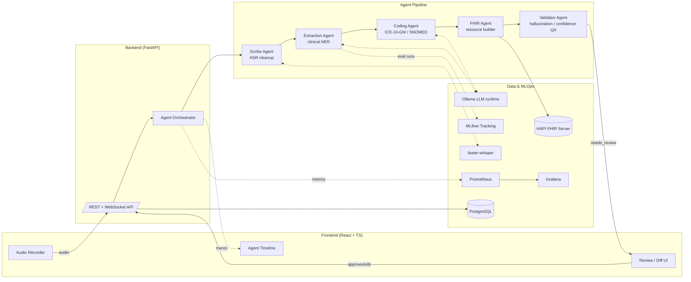

# CareScribe

**Agentic ambient clinical documentation & FHIR coding platform.**

CareScribe turns a spoken doctor–patient encounter into a reviewed,
structured, FHIR-coded clinical note — end to end, with a multi-agent
pipeline, a human-in-the-loop review UI, and the MLOps scaffolding
(experiment tracking, monitoring, CI/CD) needed to run it safely in
production.

It's a portfolio project built to demonstrate the exact skill
intersection that German health-tech / "agentic AI engineer" roles are
hiring for right now: clinical NLP, multi-agent orchestration, FHIR,
MLOps, and full-stack delivery — modeled loosely on the kind of product
pairing you see at companies like IDM gGmbH (ambient scribe + FHIR
platform), but original in design, implementation, and name. No real
patient data is used anywhere — all audio/text samples are synthetic.

> ⚠️ **Not a medical device.** This is an engineering demo. It has not
> been validated for clinical use and must never be used on real
> patient data or in real clinical decision-making.

## Why this exists

Job postings in this space (ambient clinical scribes, FHIR-based
documentation copilots) ask for one person to own the *whole* lifecycle:
train/evaluate NLP models, wire them into a multi-agent system, ship it
behind a real API + UI, and keep it observable in production. Most
portfolio projects show one slice of that. CareScribe tries to show all
of it, at MVP depth, in one coherent repo.

## Architecture



**Pipeline, in words:** audio in → **Scribe Agent** transcribes
(faster-whisper) and cleans disfluencies → **Extraction Agent** pulls
clinical entities (symptoms, meds, diagnoses, dosages) via a local LLM
→ **Coding Agent** maps entities to ICD-10-GM codes → **FHIR Agent**
assembles a FHIR `Bundle` (Encounter, Condition, MedicationStatement,
Observation) and posts it to a HAPI FHIR server → **Validator Agent**
cross-checks extracted claims against the transcript, flags
low-confidence or unsupported statements, and routes anything
uncertain to a clinician review queue. Nothing reaches FHIR storage
without passing validation or explicit human approval.

Every agent run is logged as a structured trace (inputs, outputs,
confidence, latency) so the frontend can render a step-by-step
timeline, and so the same traces can be fed back into evaluation.

## Tech stack

| Layer | Choice |
|---|---|
| ASR | faster-whisper (local, CTranslate2) |
| LLM reasoning | Ollama (local models, e.g. `llama3.1`/`qwen2.5`) via OpenAI-compatible API, with a deterministic mock mode for CI/offline dev |
| Backend | FastAPI, SQLAlchemy (async), Pydantic v2, Alembic |
| Agent orchestration | Custom lightweight graph orchestrator (`backend/app/agents`) |
| Clinical coding | ICD-10-GM sample lookup table + fuzzy matching |
| FHIR | `fhir.resources` + HAPI FHIR (Docker) |
| Database | PostgreSQL |
| MLOps | MLflow (experiment tracking), evaluation harness with P/R/F1 against synthetic gold data |
| Monitoring | Prometheus + Grafana |
| Frontend | React 18 + TypeScript + Vite |
| CI/CD | GitHub Actions (lint, type-check, pytest, frontend build) |
| Packaging | Docker Compose (single-command local stack) |

## Repo layout

```
backend/     FastAPI app, agent pipeline, ASR, FHIR, DB, tests
frontend/    React + TS + Vite client
ml/          synthetic data generation, training, evaluation, MLflow
infra/       Prometheus/Grafana config
docs/        architecture notes, roadmap
.github/     CI workflows
docker-compose.yml   full local stack (one command)
```

## Quickstart

```bash
cp .env.example .env
docker compose up --build
```

This starts: `backend` (FastAPI, :8000), `frontend` (:5173), `postgres`,
`hapi-fhir` (:8080), `ollama` (:11434), `mlflow` (:5000), `prometheus`
(:9090), `grafana` (:3000).

On first run, pull a local LLM for the agents:

```bash
docker compose exec ollama ollama pull qwen2.5:7b-instruct
```

If you skip this, the backend automatically falls back to a
deterministic **mock LLM mode** (`LLM_MODE=mock` in `.env`) — the full
pipeline still runs end-to-end, with lower-quality extraction, which is
enough to exercise the API, UI, and tests without a GPU or model
download.

Run the backend test suite directly (no Docker):

```bash
cd backend
pip install -r requirements.txt -r requirements-dev.txt
pytest
```

Run the frontend directly:

```bash
cd frontend
npm install
npm run dev
```

## Project status / roadmap

This is a working MVP skeleton, not a finished product. See
[`docs/ROADMAP.md`](docs/ROADMAP.md) for what's implemented, what's
stubbed, and what's next (model fine-tuning, real-time streaming ASR,
Kubernetes/Helm deployment, clinical trial-style evaluation).

## License

MIT — see [`LICENSE`](LICENSE). Synthetic data only; see
[`docs/ETHICS.md`](docs/ETHICS.md) for data-handling notes.
